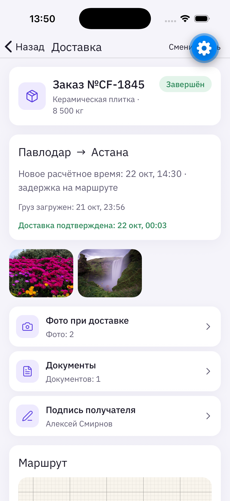
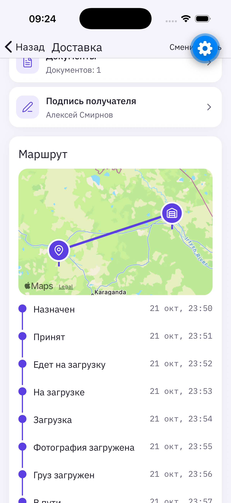
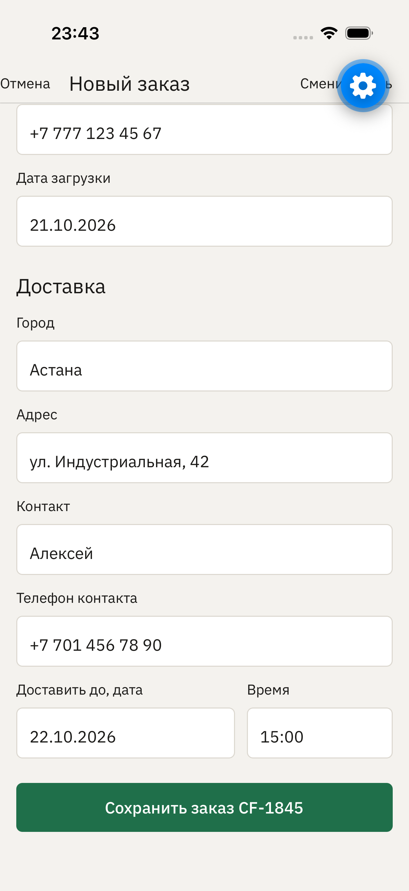
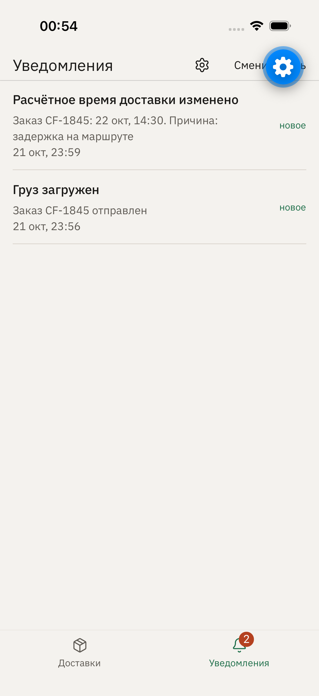

<div align="center">
  <h1>CargoFlow</h1>
  <p><strong>Контроль доставки грузов для логистической компании</strong></p>
  <p>Диспетчер, водитель, клиент и руководитель видят один актуальный статус рейса вместо звонков и переписки.</p>
  <p>
    
    
    
    
    
  </p>
</div>

| Детали доставки | Маршрут | Новый заказ | Новое время доставки |
|---|---|---|---|
|  |  |  |  |

## Что такое CargoFlow

CargoFlow — учебное мобильное приложение для перевозчика, который возит грузы между городами Казахстана. Сейчас диспетчер весь день звонит водителям, клиент звонит менеджеру, а накладные теряются в WhatsApp.

В приложении у каждой роли свой экран:

| Роль | Что делает |
|---|---|
| Диспетчер | Создаёт заказ, назначает водителя и машину, следит за статусами и проблемами |
| Водитель | Видит свой рейс, адреса и контакты, одной кнопкой отмечает этапы, прикладывает фото и документы |
| Клиент | Видит свой заказ и этапы доставки, подтверждает получение |
| Руководитель | Видит количество рейсов, задержки и загрузку водителей |

Главный сценарий: заказ **CF-1845** Павлодар → Астана, рейс **R-642**, водитель Руслан Касымов, Volvo FH 777 ABC 14. Заказ и рейс не заложены в данные заранее, их создают вживую.

## Как мы работали

Работа шла короткими задачами из [бэклога](tasks/backlog.md). Каждая задача — один коммит `T-XX` с проверкой: типы, линтер, тесты и прогон в симуляторе.

| Этап | Результат |
|---|---|
| **T-01–T-03** | Каркас Expo, вход по четырём ролям, 22 маршрута, дизайн-система «дорожный документ» |
| **T-04–T-06** | Локальный Supabase с правами по ролям (RLS) и приватным хранилищем фото, машина статусов, общий набор данных |
| **T-07** | Список рейсов диспетчера с цифрами дня и сегментами, карточка рейса с историей событий |
| **T-08a** | Единый набор из 10 действий. Сервер выполняет каждое в одной транзакции, проверяет права и этапы, не создаёт дублей при повторе |
| **T-08** | Заказы, форма заказа, назначение рейса, «Сбросить демо» |
| **T-09** | Рабочее место водителя: «Сегодня», «История», экран рейса, фото, документы, передача груза, проблема |
| **T-10–T-11** | Фото по этапам из камеры или галереи, накладная, передача груза получателю |
| **T-12** | Клиент: доставки, этапы, «Подтвердить получение», уведомления с бейджем |
| **T-13** | «Внимание» у диспетчера, принятие проблемы и сдвиг срока доставки |
| **T-15** | Дашборд руководителя: показатели месяца, водители, направления |
| **T-16–T-17** | Очередь действий водителя без сети (сохраняется после перезапуска, отправка по порядку без дублей), PDF-акт рейса |
| **Вход и база** | Вход по email и паролю через Supabase Auth, 7 тестовых учётных записей, чистая база одной командой |
| **Дизайн** | Фиолетовый акцент, карточки, карта маршрута у клиента, водителя и диспетчера (положение по этапу, без GPS) |

## Статус сейчас

- Главный сценарий пройден в интерфейсе на iOS: заказ CF-1845 → рейс R-642 → водитель принимает рейс, фото после загрузки, «В пути» → клиент видит статус → выгрузка, фото, накладная №457, получатель Алексей Смирнов → клиент подтверждает → рейс завершён.
- Задержка пройдена: водитель сообщает о закрытии дороги на 90 минут, диспетчер принимает проблему во «Внимании», клиент получает новое время 14:30 с причиной «задержка на маршруте».
- Данные сохраняются после перезапуска. Повторное нажатие не создаёт дублей.
- Android: сборка проходит, приложение открывается в Expo Go на Android 15. Полный сценарий на Android ещё не пройден: эмулятор на компьютере разработки нестабилен, нужна проверка на телефоне.

- Работа без сети проверена на сервере: водитель отметил два этапа при недоступном сервере, приложение перезапущено, после восстановления связи оба события записаны в базу по одному разу.
- PDF-акт рейса формируется у диспетчера и клиента.

## Что впереди

1. Пройти сценарий на Android-телефоне через Expo Go.
2. Сохранять вход в серверном режиме после перезапуска приложения.
3. Три полных прогона, сборка APK, видеоролик для защиты.

## Правила, которые соблюдает приложение

- Статусы идут строго по порядку: назначен → принят → едет на загрузку → … → груз передан → ожидает подтверждения → доставлен → завершён.
- «Груз загружен» нельзя отметить без фото после загрузки. «Груз передан» нельзя отметить без получателя и фото при выдаче.
- Каждый шаг пишется отдельным событием с временем и автором. История не переписывается.
- Подтверждает получение клиент или диспетчер. Отменить рейс может только диспетчер и только до загрузки.
- Клиент не видит телефон водителя, внутренние комментарии и детали служебных проблем.

## Запуск

Нужны Node.js 20+ и Expo Go на телефоне (SDK 57).

```bash
cd app
npm install
npx expo start
```

На экране входа два режима:

- **Демо без сети** — выбор роли, данные хранятся на устройстве, сервер не нужен. Сбросить данные можно в Настройках.
- **Вход по логину** — настоящая авторизация в Supabase: роль и права берутся из профиля в базе, каждое действие проверяет сервер.

## Проверка базы данных

Нужны Docker Desktop и [Supabase CLI](https://supabase.com/docs/guides/local-development/cli/getting-started).

```bash
cd app
npm run backend           # supabase start → чистая база из миграций и seed → app/.env
npx expo start            # перезапустить Metro после изменения app/.env
```

Для телефона в той же Wi-Fi сети вместо `npm run backend` выполните `npm run backend:lan`: в `app/.env` попадёт адрес компьютера в сети, а не 127.0.0.1. Для эмулятора Android подойдёт адрес `http://10.0.2.2:55321`.

Тестовые учётные записи локальной базы. Пароль у всех: **`cargoflow2026`**.

| Роль | Email | Что видит |
|---|---|---|
| Диспетчер | `dispatcher@cargoflow.test` | все рейсы и заказы перевозчика, создаёт заказы и рейсы |
| Водитель | `driver@cargoflow.test` | только свои рейсы (Руслан Касымов) |
| Водитель | `askhat@cargoflow.test` | только свои рейсы, в том числе R-648 с задержкой |
| Водитель | `ermek@cargoflow.test`, `bauyrzhan@cargoflow.test` | только свои рейсы |
| Клиент | `client@cargoflow.test` | только заказы ТОО «СтройКомплект», без телефона водителя и служебных комментариев |
| Руководитель | `manager@cargoflow.test` | все рейсы перевозчика, только чтение |

Что проверить руками: войдите диспетчером и создайте заказ и рейс, затем войдите водителем `driver@cargoflow.test` и проведите рейс по этапам, затем клиентом подтвердите получение. Попытка пропустить этап, отметить «Груз загружен» без фото или подтвердить чужой рейс сервер отклонит.

Studio локальной базы: http://127.0.0.1:55323. Пароль `cargoflow2026` существует только в локальных тестовых данных; в облачной базе такие учётные записи создавать нельзя.

## Проверки

```bash
cd app
npx tsc --noEmit
npx expo lint
npm test                  # логика статусов, действий, данных
npm run test:backend      # нужен локальный Supabase: вход всех учётных записей, права, сценарий через сервер
cd .. && supabase test db # права и действия на стороне базы
```

Сценарии для симулятора лежат в `app/maestro/`.

## Структура

| Папка | Что внутри |
|---|---|
| `app/` | Мобильное приложение: экраны `app/app`, логика `app/src`, тесты `app/tests` |
| `supabase/` | Схема, миграции, данные, тесты базы |
| `docs/` | Исследование, ТЗ, модель данных, дизайн, архитектура, сценарий ролика |
| `tasks/` | Бэклог задач |
| `setup/` | Генератор данных и настройка локального сервера |

## Ограничения

Это учебный проект. Режим «Демо без сети» — выбор роли без пароля для показа на одном устройстве. Режим «Вход по логину» работает через Supabase Auth, но в нём нет регистрации и восстановления пароля. Демо-данные не синхронизируются между устройствами. GPS, маршруты, оплата и интеграции не входят в задачу.
