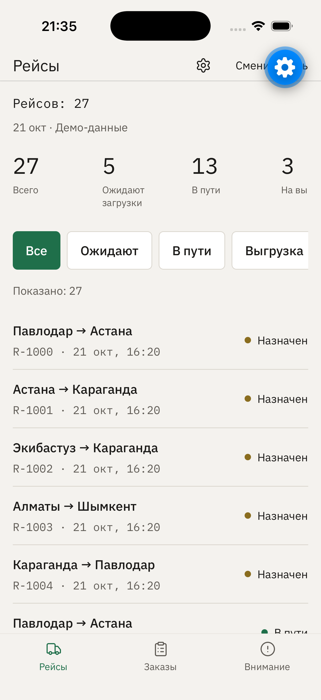
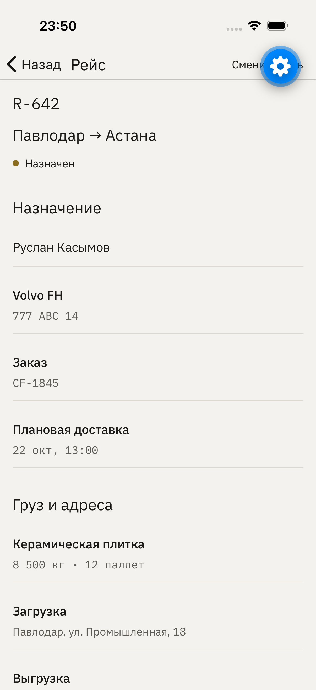
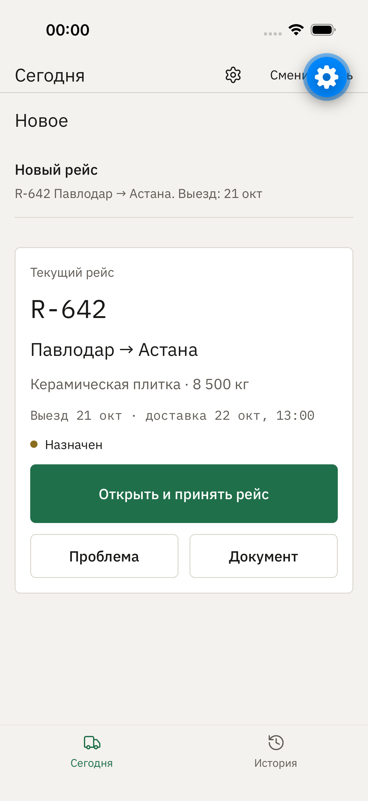

<div align="center">
  <h1>CargoFlow</h1>
  <p><strong>Контроль доставки грузов для логистической компании</strong></p>
  <p>Диспетчер, водитель, клиент и руководитель видят один актуальный статус рейса вместо звонков и переписки.</p>
  <p>
    
    
    
    
    
  </p>
</div>

| Рейсы диспетчера | Новый заказ | Рейс R-642 | Водитель: Сегодня |
|---|---|---|---|
|  |  |  |  |

## Что такое CargoFlow

CargoFlow — учебное мобильное приложение для перевозчика, который возит грузы между городами Казахстана. Сейчас диспетчер весь день звонит водителям, клиент звонит менеджеру, а накладные теряются в WhatsApp.

В приложении у каждой роли свой экран:

| Роль | Что делает |
|---|---|
| Диспетчер | Создаёт заказ, назначает водителя и машину, следит за статусами и проблемами |
| Водитель | Видит свой рейс, адреса и контакты, одной кнопкой отмечает этапы, прикладывает фото и документы |
| Клиент | Видит свой заказ и этапы доставки, подтверждает получение |
| Руководитель | Видит количество рейсов, задержки и загрузку водителей |

Главный сценарий: заказ **CF-1845** Павлодар → Астана, рейс **R-642**, водитель Руслан Касымов, Volvo FH 777 ABC 14. Заказ и рейс не заложены в данные заранее, их создают вживую.

## Как мы работали

Работа шла короткими задачами из [бэклога](tasks/backlog.md). Каждая задача — один коммит `T-XX` с проверкой: типы, линтер, тесты и прогон в симуляторе.

| Этап | Результат |
|---|---|
| **T-01–T-03** | Каркас Expo, вход по четырём ролям, 22 маршрута, дизайн-система «дорожный документ» |
| **T-04–T-06** | Локальный Supabase с правами по ролям (RLS) и приватным хранилищем фото, машина статусов, общий набор данных |
| **T-07** | Список рейсов диспетчера с цифрами дня и сегментами, карточка рейса с историей событий |
| **T-08a** | Единый набор из 10 действий. Сервер выполняет каждое в одной транзакции, проверяет права и этапы, не создаёт дублей при повторе |
| **T-08** | Заказы, форма заказа, назначение рейса, «Сбросить демо» |
| **T-09** | Рабочее место водителя: «Сегодня», «История», экран рейса, фото, документы, передача груза, проблема |

## Статус сейчас

- Работает: создание CF-1845 и R-642 в форме, уведомление водителю, прохождение этапов до загрузки. Данные сохраняются после перезапуска.
- Весь цикл до «Рейс завершён» проверен автотестами на demo-данных и на локальном сервере. В интерфейсе он пройден до загрузки.
- Ещё не готовы экраны клиента, вкладка «Внимание», дашборд руководителя, работа без сети и экспорт в PDF.

## Что впереди

1. Клиент: доставки, этапы, подтверждение получения.
2. Задержка: водитель сообщает о проблеме, диспетчер сдвигает срок, клиент видит новое время.
3. Дашборд руководителя, центр уведомлений.
4. Очередь действий водителя без сети, PDF-история рейса.
5. Три полных прогона, сборка Android, видеоролик для защиты.

## Правила, которые соблюдает приложение

- Статусы идут строго по порядку: назначен → принят → едет на загрузку → … → груз передан → ожидает подтверждения → доставлен → завершён.
- «Груз загружен» нельзя отметить без фото после загрузки. «Груз передан» нельзя отметить без получателя и фото при выдаче.
- Каждый шаг пишется отдельным событием с временем и автором. История не переписывается.
- Подтверждает получение клиент или диспетчер. Отменить рейс может только диспетчер и только до загрузки.
- Клиент не видит телефон водителя, внутренние комментарии и детали служебных проблем.

## Запуск

Нужны Node.js 20+ и Expo Go на телефоне (SDK 57).

```bash
cd app
npm install
npx expo start
```

Приложение по умолчанию работает в demo-режиме: без сервера и сети, данные хранятся на устройстве. Сбросить их можно в Настройках.

Локальный сервер (необязательно, нужен Docker и Supabase CLI):

```bash
supabase start            # из корня репозитория
supabase db reset         # схема, миграции и данные
node setup/local-backend.mjs   # тестовые пользователи, пишет app/.env
```

## Проверки

```bash
cd app
npx tsc --noEmit
npx expo lint
npm test                  # логика статусов, действий, данных
npm run test:backend      # нужен локальный Supabase
cd .. && supabase test db # права и действия на стороне базы
```

Сценарии для симулятора лежат в `app/maestro/`.

## Структура

| Папка | Что внутри |
|---|---|
| `app/` | Мобильное приложение: экраны `app/app`, логика `app/src`, тесты `app/tests` |
| `supabase/` | Схема, миграции, данные, тесты базы |
| `docs/` | Исследование, ТЗ, модель данных, дизайн, архитектура, сценарий ролика |
| `tasks/` | Бэклог задач |
| `setup/` | Генератор данных и настройка локального сервера |

## Ограничения

Это учебный проект. Demo-вход по ролям и локальные тестовые пользователи — не настоящая авторизация. Синхронизации между устройствами пока нет. GPS, маршруты, оплата и интеграции не входят в задачу.
